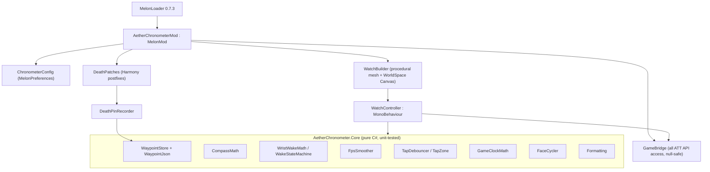

# Aether-Chronometer — Architecture & Verified Game API Findings

All ATT names below were **verified by metadata/IL inspection** of the installed game
(`A Township Tale_Data/Managed/Root.Township.dll`, assembly version `0.0.39.2`, game build
`main-1.7.2.1.42203`, Unity `2020.3.23f1`) using Mono.Cecil (shipped with MelonLoader), and
cross-checked against the in-game hierarchy dump in `MelonLoader/GameObjectDump.txt`
(UnityExplorer, scene *Overworld Chunked*). Nothing in this document is guessed; where the mod
relies on a *convention* rather than a verified fact, it is explicitly marked **ASSUMPTION** and
exposed as a `MelonPreferences` value.

The inspection scripts used are reproducible: they live in the conversation scratch folder and
are summarised in [Appendix A](#appendix-a--how-the-findings-were-produced).

---

## 1. Runtime environment (verified)

| Item | Value | Source |
|---|---|---|
| Scripting backend | **Mono** (`MonoBleedingEdge/`, `A Township Tale_Data/Managed/*.dll` present, no `GameAssembly.dll`) | install dir |
| MelonLoader | **v0.7.3 Open-Beta**, `Game Type: MonoBleedingEdge`, `Runtime Type: net35` | `MelonLoader/Latest.log` |
| Game identity | `Game Developer: Alta`, `Game Name: A Township Tale` → `[MelonGame("Alta", "A Township Tale")]` | `Latest.log` |
| Main game assembly | `Root.Township.dll` (no `Assembly-CSharp.dll` exists) | `Managed/` |
| Mod target framework | **.NET Framework 4.7.2** (`mscorlib 4.0.0.0`) — identical to every working mod in `Mods/` (e.g. `InfoGui.dll` carries `TargetFrameworkAttribute(".NETFramework,Version=v4.7.2")`) | Cecil on `Mods/InfoGui.dll` |
| Harmony | `0Harmony 2.10.2.0` (`MelonLoader/net35/0Harmony.dll`) | |
| Input | `Unity.InputSystem 1.4.4` (used by existing mods for hotkeys) | |

**IL2CPP interop:** not applicable. Because ATT PCVR is Mono, custom `MonoBehaviour`s are used
directly; `ClassInjector.RegisterTypeInIl2Cpp<T>()` / `Il2CppSystem` collections are **not**
needed (and `Il2CppInterop` is not shipped in this install). `WatchController` is a plain
`UnityEngine.MonoBehaviour`. A guard in `AetherChronometerMod.OnInitializeMelon` logs an error and
disables the mod if it ever finds itself in an IL2CPP process (`GameAssembly.dll` present).

---

## 2. Verified ATT classes, members and hook points

### 2.1 Local player & VR rig

| Purpose | Verified symbol (assembly `Root.Township`, global namespace unless shown) |
|---|---|
| Current local player | `PlayerController.Current` — `public static PlayerController` (property). Also used by `TavernEssentials.dll` (`PlayerController::get_Current`). |
| Local-player filter | `PlayerController.IsLocalPlayer` — `public bool` |
| Gameplay character type | `Alta.Character.PlayerCharacter : SmoothLocomotionPlayerController : VRPlayerController : PlayerController` (main-menu rig is `MainMenuPlayerController`, which the mod ignores by default) |
| Hands | `PlayerController.LeftController`, `PlayerController.RightController` — `public Controller` |
| Hand component | `Controller.Hand` — `public Alta.Character.Hand`; `Hand.HandIndex` (`HandIndex.Left/Right/Both`), `Hand.OtherHand` |
| Visible IK wrist | `Alta.Character.Hand.IKWrist` → IL: `MasterHand.get_IKHandRoot()` |
| Wrist / fingertip bones | Hierarchy names (GameObjectDump lines 229264–229520): `wrist_L_jnt`, `wrist_R_jnt`, `indexEnd_L_jnt`, `indexEnd_R_jnt` (children of `hand_male_body_default_[L|R]_01` under `"[Left|Right] Master Hand"`, itself under the `Controller` GameObject `"<id> - Left Hand"`) |
| Head / camera | `PlayerController.Head` (`Transform`), `PlayerController.Camera` (`UnityEngine.Camera`, GameObject `"VR Head (eye)"`); `Camera.main` used only as fallback |
| Feet position | `PlayerController.PlayerFeetPosition` — `public Vector3` |
| Alive state | `PlayerController.IsAlive`, `IsDowned`, `IsSpirit` — `public bool` |
| Player-change events | `PlayerController.CurrentPlayerChanged` — `public static event Action<PlayerController>`; `PlayerController.LocalPlayerSet` — `public static event Alta.Character.PlayerControllerHandler` (`void Invoke(PlayerController)`) |
| Haptics | `Controller.TriggerHaptic(float strength, float duration, float frequency)` — `public` (forwards to `PlayerInput.TriggerHaptic`). Fallback: `UnityEngine.XR.InputDevices.GetDeviceAtXRNode(...).SendHapticImpulse`. |

Wrist resolution order used by `GameBridge.ResolveWrist(hand)`:
1. `Hand.IKWrist` subtree → descendant named `wrist_{L|R}_jnt`
2. `Controller.transform` subtree → descendant named `wrist_{L|R}_jnt`
3. `Hand.IKWrist` itself, then `Controller.transform` (raw tracked controller)

Fingertip resolution (`GameBridge.ResolveIndexTip`): same order with `indexEnd_{L|R}_jnt`, falling
back to `Controller.GripPoint`, then `Controller.transform`.

### 2.2 Health, hunger, stamina (stat system)

| Purpose | Verified symbol |
|---|---|
| Player health component | `PlayerController.Health` → `HealthObject` (runtime type `PlayerHealth : HealthObject`, GameObject `"<id> - Health"` with `Alta.StatSystem.StatManager`) |
| Health values | `HealthObject.Health`, `HealthObject.MaxHealth` — `public float` |
| Stat manager | `HealthObject.StatManager` → `Alta.StatSystem.StatManager` |
| Stat lookup by name | `StatManager.GetStat(string name, out Alta.StatSystem.Stat stat)` → `bool` |
| Stat value/range | `Stat.Value`, `Stat.Minimum`, `Stat.Maximum` — `public float`; `Stat.Definition.Name` |
| All stats | `StatManager.Stats` — `Dictionary<StatDefinition, Stat>` |
| **Verified stat-name literals** | `"health"` (`HealthObject.get_HealthStat` IL), `"Hunger"` and `"Fullness"` (`SmoothLocomotion.CheckSetEnabled` IL), `"hunger"` (`StatManager.DeathReset` IL) |
| Stamina | No name literal exists in code; ATT stamina is per hand (`ClimbingSettings.LeftHandStamina` / `RightHandStamina` are `StatDefinition` assets; `Features.Climbing.HandStaminaManager.Stamina` → `Stat`). The mod enumerates `StatManager.Stats` and selects definitions whose `Name` contains `"stamina"` (case-insensitive), averaging left/right. The resolved names are printed by the diagnostics command. |

Hunger % shown on the watch = `Fullness` (how full the player is) when present, otherwise `Hunger`
(`Value / Maximum`).

### 2.3 Death events (Harmony targets)

| Target | Why | Filter |
|---|---|---|
| `HealthObject.OnKilled()` — **public, instance, void** | IL: invokes the `Killed` event; called on the server *and* on clients via `HealthObject.SyncDeath` (`if (!NetworkSceneManager.IsServer) OnKilled()`), so it fires for the local client in multiplayer. | `__instance == PlayerController.Current.Health` and `PlayerController.Current.IsLocalPlayer` |
| `PlayerHealth.OnDowned()` — **public, instance, void** | IL: `PlayerHealth.HandleObjectReachedZeroHealth` → `OnDowned()` → `Downed` event; this is the "downed / spirit" transition. | `__instance.Player != null && __instance.Player.IsLocalPlayer` |
| Fallback poll | `PlayerController.IsAlive` transition `true → false` in `OnUpdate` | local player only |

All three paths feed `DeathPinRecorder`, which de-duplicates events within 5 s and writes the
`[LAST DEATH]` waypoint at `PlayerController.PlayerFeetPosition` captured inside the postfix.

### 2.4 World time / day–night (verified IL math)

`GameTimeManager : Alta.Networking.NetworkEntityBehaviour`

| Member | Kind |
|---|---|
| `GameTimeManager.Instance` | `public static` field |
| `DayProgress` | `public float` — fraction of the current in-game day, `[0,1)` |
| `CurrentNormalizedTime` | `public float` — fraction of the *normalized* timeline |
| `DayToNightRatio`, `DayDurationMinutes` | `public float` |
| `IsNight` | `public static bool` |
| `smallHoursNightPercentage` | **private** `float` (read via `HarmonyLib.AccessTools.Field`, default 0 if unavailable) |
| `DuskReached`, `DawnReached`, `NightChanged` | `public static event` |

Decoded from IL (`UpdateTimeline`, `GetNormalizedTime`):

```
s        = (1 - DayToNightRatio) * smallHoursNightPercentage
IsNight  = DayProgress > DayToNightRatio + s  &&  DayProgress < 1 - s
normalized(p) = p <= r ? 0.5 * p / r
                       : (1 + p - 2r) / (2 - 2r)          // r = DayToNightRatio
realSecondsPerDay = DayDurationMinutes * 60               // progress += dt / realSecondsPerDay
```

So the normalized timeline puts the daylight phase in `[0, 0.5]` and the dark phase in
`(0.5, 1)`. **ASSUMPTION (documented convention):** the watch maps normalized `0.0 → 06:00`,
`0.5 → 18:00` (`ClockOffsetHours = 6`, configurable). Countdowns use the exact `IsNight`
predicate above:

```
not night, p <= r+s : toDusk = (r + s) - p
not night, p >= 1-s : toDusk = (1 - p) + r + s
night               : toDawn = (1 - s) - p
seconds             = delta * DayDurationMinutes * 60
```

Implemented and unit-tested in `Core/GameClockMath.cs`.

### 2.5 Held / holstered item durability

| Purpose | Verified symbol |
|---|---|
| Held item per hand | `Controller.TryGetHeldPickup(out Pickup pickup)` → `bool` |
| Durability component | `Pickup.DurabilityModule` → `DurabilityModule` (may be null) |
| Remaining durability | `DurabilityModule.Integrity` — `public float`. IL: starts at 1, `RemoveIntegrity(a)` does `integrity *= (1 - a)`, `currentDurability = baseDurability * integrity` ⇒ **`Integrity` is the normalized remaining fraction**; watch shows `Integrity * 100 %`. |
| Durability stage | `DurabilityModule.CurrentStage` — `public int` |
| Item name | `Pickup.Item` → `Alta.Inventory.Item` (`ScriptableObject`, `.name`), fallback `GameObject.name` without `(Clone)` |
| Belt / back holsters | `Alta.Character.PlayerCharacter.BeltDocks`, `.BackDocks` → `PickupDockGroup : ComponentGroup<Alta.Inventory.PickupDock>`; `ComponentGroup<T>.Components` → `List<T>`; `PickupDock.DockedPickup` → `Pickup`, `PickupDock.HasDockedPickup` |

---

## 3. Mod architecture



* **`AetherChronometer.Core`** — zero Unity/MelonLoader references (`netstandard2.0`). It uses its
  own `Vec3` struct so every algorithm runs under `dotnet test`. The mod project compiles these
  same source files directly into `AetherChronometer.dll`, so the shipped mod is **one DLL** with no
  extra dependencies (no AssetBundles, no Newtonsoft — JSON is a small purpose-built
  reader/writer).
* **`GameBridge`** — the only file that touches ATT types. Every call is wrapped so a missing
  object during loading screens returns `null`/`false` instead of throwing.
* **`WatchController`** — per-frame: resolve camera, gaze-wake, swing suppression, fingertip
  taps, face rendering (throttled to 10 Hz for text), arrow rotation (every frame).

### 3.1 Lifecycle / defensive handling

| Event | Behaviour |
|---|---|
| `OnSceneWasLoaded` / `OnSceneWasUnloaded` | Destroy stale watch, clear cached transforms, schedule re-attach probe. |
| `PlayerController.CurrentPlayerChanged` | Schedule re-attach probe (subscribed once, unsubscribed on deinit). |
| Re-attach probe (every 1 s while not attached) | Attach only when `PlayerController.Current` is non-null, `IsLocalPlayer`, is a `PlayerCharacter` (unless `AttachInMainMenu`), and a wrist transform resolves. |
| Wrist destroyed (Unity-null) | Watch is a child of the wrist, so it dies with it; the controller detects the null root next frame and re-probes. |
| Preference change (file watcher reload) | `OnPreferencesLoaded` → rebuild watch with new hand/scale/offsets. |

### 3.2 Coordinate & interaction math

* **Compass yaw** (`CompassMath.YawFromForward`): `yaw = atan2(f.x, f.z)` in degrees normalized
  to `[0,360)`. **ASSUMPTION:** world `+Z` = North (Unity convention); `NorthOffsetDegrees`
  preference rotates the rose if the ATT map uses another north.
* **Cardinal**: 8 sectors of 45°, centred on N (`[337.5, 22.5) → N`).
* **Waypoint bearing**: `bearing = yaw(target - player)` on XZ; arrow angle on the watch face =
  `wrap180(bearing - playerYaw)` (0 = straight ahead, +90 = to the right). Distance shown is 3D;
  horizontal distance and Δheight are also computed.
* **Gaze wake**: `angle = acos(dot(n̂, (eye - face)̂))`, where `n̂` is the screen normal
  (watch local `-Z` of the canvas, i.e. the side the text faces). Wake when
  `angle < WakeAngle`; sleep when `angle > WakeAngle + Hysteresis` (default 55° / 10°).
  Swing suppression: wrist speed `> SwingSpeed` (default 2.2 m/s) forces sleep for
  `SwingHoldoff` (0.6 s). Display alpha eases with `FadeSpeed` per second.
* **Taps**: fingertip position is transformed into watch-face local space; `TapZone` is an
  axis-aligned box (x/y extents on the face, z depth in front/behind). A tap fires on zone
  *entry* only, requires the fingertip to exit before it can fire again, and is rate-limited by a
  0.35 s global cooldown (`TapDebouncer`).
* **FPS**: exponential moving average of `unscaledDeltaTime` (`α = 0.1` default), reported as
  `1/avg` FPS and `avg*1000` ms.

### 3.3 Persistence

`UserData/AetherChronometer_Waypoints.json` (via `MelonEnvironment.UserDataDirectory`):

```json
{
  "version": 1,
  "selected": 0,
  "nextLabel": 3,
  "waypoints": [
    { "label": "Base/Town", "x": 12.5, "y": 130.0, "z": -40.25, "isDeath": false, "createdUtc": "2026-11-22T11:00:00Z" }
  ]
}
```

Writes are atomic (`.tmp` + replace). Corrupt files are renamed to `.bak` and an empty store
is used. Only one `[LAST DEATH]` entry exists; a new death replaces it.

---

## 4. Configuration (`UserData/MelonPreferences.cfg`, category `AetherChronometer`)

See `README.md` for the full table; every threshold in §3.2 is a preference.

---

## Appendix A — how the findings were produced

1. `Mono.Cecil` (from `MelonLoader/net472`) loaded in Windows PowerShell; every type in
   `Root.Township.dll` dumped with fields/properties/events/method signatures.
2. Targeted IL disassembly of: `GameTimeManager.{get_CurrentTime, GetNormalizedTime,
   UpdateTimeline, get_NightDuration, get_DayDuration, OnNightChanged}`,
   `DurabilityModule.{get_Integrity, RemoveIntegrity, ReevaluateRemainingDurabilityFromIntegrity}`,
   `HealthObject.{get_HealthStat, OnKilled, SyncDeath}`, `PlayerHealth.{HandleObjectReachedZeroHealth, OnDowned}`,
   `SmoothLocomotion.CheckSetEnabled`, `Alta.Character.Hand.{get_IKWrist, get_HandIKTarget}`.
3. `ldstr` scan of `Root.Township.dll` for stat-name literals passed to
   `StatManager.GetStat(string, out Stat)`.
4. Member-reference scan of installed mods (`TavernEssentials`, `WaypointMinimap`, `InfoGui`) to
   confirm `PlayerController.Current` and the `[MelonGame("Alta","A Township Tale")]` identity are
   what working mods use.
5. Bone names taken from `MelonLoader/GameObjectDump.txt` (`VR Player Character New(Clone)`).

## Note
1. AetherChronometer was the previous name for now Townex.
2. Waypoints were removed since I forgot there is already a waypoint mod.
